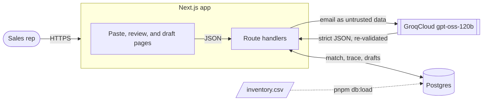

# email-to-draft

Turn a customer's request-for-quote email into a priced draft quote in seconds instead of fifteen minutes of retyping.

**Live:** https://email-to-draft.apak.ca

A sales rep pastes an RFQ email exactly as it arrived: a table, a bullet list, a forwarded chain, or a list of NSNs.
An LLM pulls out the line items, every line is matched against inventory with a confidence the rep can read at a glance, and the rep reviews, fixes, and saves a draft priced from inventory.

## Features

- **Paste anything.** Tables, bullets, reply chains, NSN-only lists, mixed units ("2 boxes of 100", "a dozen"), and free-text descriptions.
- **Structured extraction.** GroqCloud `openai/gpt-oss-120b` with a strict JSON schema, re-validated with zod. The model only transcribes; code normalizes NSNs, converts units, and checks that every part number and NSN actually appears in the email.
- **Matching the rep can trust.** Exact NSN and part number first, then fuzzy part number and description matching in Postgres. Each line is **High** (safe to skim), **Low** (the rep picks from candidates), or **None** (not in inventory, kept unpriced), always with a one-sentence reason and never a raw score.
- **Fast review.** Requested and on-hand quantities side by side, supplier choice with a sensible default, one markup per draft, one-click "quote what we have" on short lines, and a save button that says exactly what is left to do.
- **Prices from inventory only.** The server re-prices every line from inventory cost and the draft's markup on save and snapshots the result. The client never sends a price.
- **Failures never reach the rep.** Malformed or truncated model output, timeouts, rate limits, and provider errors become typed errors with Retry and Continue manually. Every extraction attempt is stored with its raw output, so you can trace what happened.

## How it works



1. `POST /api/extractions` records the email, asks the model for line items, validates and grounds them, matches each line in Postgres, and stores the result for the review page.
2. `/review/[extractionId]` renders the lines next to the original email. All edits stay in the browser tab until the rep saves.
3. `POST /api/quotes` re-prices every line from inventory, saves one draft per extraction, and the draft opens read-only from `/quotes`.

The full design, including contracts and the matching rules, is in [docs/technical-design.md](docs/technical-design.md).

## Tech stack

| Concern | Choice |
| --- | --- |
| App | Next.js 16 (App Router), React 19, TypeScript (strict) |
| UI | Tailwind CSS 4, shadcn/ui on Base UI |
| Data | Postgres with `pg_trgm` and `fuzzystrmatch`, Drizzle ORM and drizzle-kit migrations |
| Validation | zod 4 at every boundary: CSV rows, LLM output, API requests, environment |
| LLM | GroqCloud `openai/gpt-oss-120b` through the OpenAI SDK |
| Tests | Vitest (unit, component, integration against a real database), Playwright |
| Hosting | Railway (app and Postgres), Cloudflare DNS |

## Getting started

### Prerequisites

- Node 24 and pnpm 12 (`corepack enable` picks the version pinned in `package.json`)
- Docker, for the local Postgres
- Python 3.9 or newer, to generate sample data
- A GroqCloud API key from https://console.groq.com/keys

### Run it locally

```sh
pnpm install
cp .env.example .env          # then set LLM_API_KEY
pnpm db:up                    # Postgres 17 in Docker on port 5432
pnpm db:migrate

python3 generate_mock_data.py --rows 1000   # writes mock_data/ (gitignored)
pnpm db:load mock_data/shared/inventory.csv

pnpm dev
```

Open http://localhost:3000 and paste one of the sample emails from `mock_data/mock_b/rfq_emails/`.

`generate_mock_data.py` is deterministic: the same seed always produces the same inventory and emails.

### Configuration

| Variable | Required | Default | Purpose |
| --- | --- | --- | --- |
| `DATABASE_URL` | Yes | | Postgres connection string |
| `LLM_API_KEY` | Yes | | GroqCloud API key, server only |
| `LLM_BASE_URL` | No | `https://api.groq.com/openai/v1` | Any OpenAI-compatible endpoint |
| `LLM_MODEL` | No | `openai/gpt-oss-120b` | Must support strict `json_schema` output |

The environment is validated at startup, so a missing or malformed variable stops the server with a clear message instead of failing on the first request.

## Scripts

| Command | What it does |
| --- | --- |
| `pnpm dev` | Start the dev server |
| `pnpm build`, `pnpm start` | Production build and server |
| `pnpm lint` | ESLint with zero warnings allowed |
| `pnpm typecheck` | Generate route types, then `tsc --noEmit` |
| `pnpm test` | All Vitest projects |
| `pnpm test:unit` | Unit and component tests only, no database |
| `pnpm test:int` | Integration tests against Postgres |
| `pnpm test:e2e` | Playwright end-to-end tests |
| `pnpm db:up` | Start Postgres in Docker |
| `pnpm db:migrate` | Apply migrations |
| `pnpm db:generate` | Generate a migration from schema changes |
| `pnpm db:load <csv>` | Replace the inventory with a CSV, in one transaction |

## Testing

- **Unit and component tests** cover NSN and part number normalization, unit conversion, grounding, the confidence rules, pricing, and the review screen's state and save gate.
- **Integration tests** (`*.int.test.ts`) run against a real Postgres. Each run creates its own randomly named database, so parallel runs never collide.
- **End-to-end tests** run the built app in Chromium with Playwright.
- Tests never call the real model. A fake LLM client produces malformed JSON, schema violations, invented part numbers, timeouts, and rate limits on demand.

## Project structure

```
src/
  app/                  pages and route handlers (/, /review, /quotes, /api/*)
  components/           paste, review, and quote UI
  lib/
    contracts/          zod schemas shared by the server and the UI
    extraction/         LLM client, prompt, validation, grounding, unit conversion
    matching/           exact and fuzzy matching, confidence, default supplier
    quotes/             saving and reading drafts
    inventory/          CSV parsing and loading
    pricing.ts          cost plus markup, in integer cents
    db/                 Drizzle schema and client
scripts/                inventory loader and review fixture seeding
drizzle/                SQL migrations
e2e/                    Playwright tests
.railway/railway.ts     Railway infrastructure as code
docs/                   product and engineering documentation
```

## Deployment

Every push to `main` deploys to Railway.
The build runs on Railpack, migrations run as a pre-deploy step, and traffic moves only after the healthcheck passes.
See [docs/deploy.md](docs/deploy.md) for environment variables, loading inventory in production, the custom domain, and rollback.

## Documentation

| Document | What's in it |
| --- | --- |
| [Project brief](docs/brief.md) | The original problem statement and agreed scope |
| [PRD](docs/PRD.md) | Users, goals, requirements, failure behavior, acceptance tests |
| [Technical design](docs/technical-design.md) | Architecture, data model, contracts, extraction and matching |
| [Decision log](docs/decisions.md) | Each significant choice, the alternatives, and the trade-off |
| [Known issues](docs/known-issues.md) | Open bugs and accepted limitations |
| [Deploy runbook](docs/deploy.md) | How production runs and how to operate it |
| [Task plan](docs/tasks.md) | How the build was split into parallel tasks |
