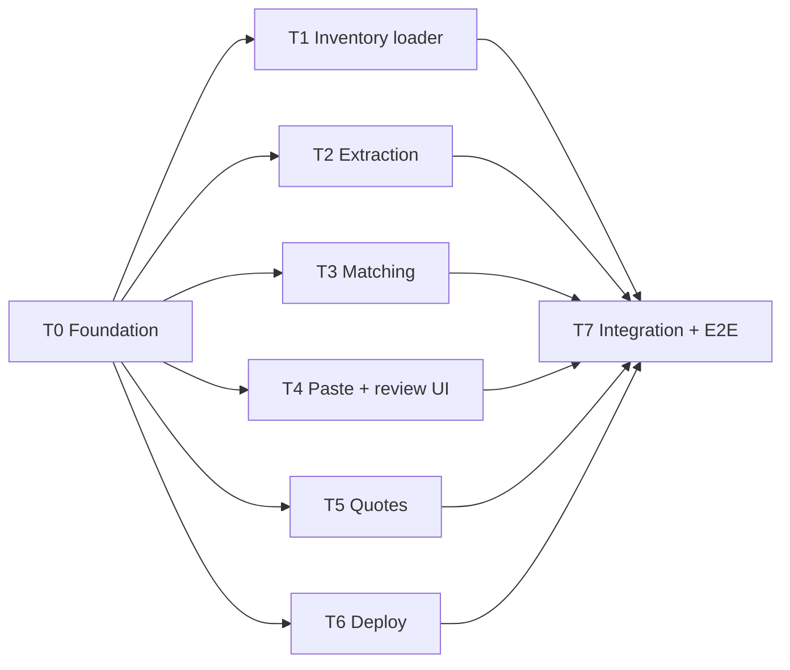

# Task Plan

Status: Draft v0.1 (2026-10-11).
This plan splits the MVP into tasks that sub-agents can run in parallel.
Read [PRD.md](PRD.md) for what and why, and [technical-design.md](technical-design.md) for the contracts every task builds against.

## How parallel work stays conflict-free

- **Contracts first.** T0 lands every shared type, the DB schema, and stub modules before anything else starts. After that, tasks only talk to each other through those contracts.
- **File ownership.** Each task owns specific paths, listed on its card. A task never edits paths it does not own. If it needs a contract change, it proposes the change in its final report instead of making it.
- **Stubs and fixtures.** Every module from technical design section 5.7 exists as a stub after T0. UI work uses fixtures until the real modules land.
- **One branch per task.** Each agent works in its own git worktree, branched from `main` after T0 is merged. Merge in any order. T7 runs last.

## Dependency graph

T1 to T6 run in parallel.
T3 can start on its own fixture inventory and does not need to wait for T1.

## Time plan (3-hour budget)

| Window | Work |
| --- | --- |
| 0:00 to 0:20 | T0 (one agent, serial) |
| 0:20 to 1:30 | T1 to T6 in parallel |
| 1:30 to 2:15 | T7 integration, run the 12 emails, tune thresholds |
| 2:15 to 2:45 | P1 backlog: fault injection demo, trace view |
| 2:45 to 3:00 | Verify the live deploy, write presentation notes from [decisions.md](decisions.md) |

## Agent brief (paste this at the top of every sub-agent prompt)

> You are working on the RFQ email to draft quote app in this repository.
> Read `docs/PRD.md`, `docs/technical-design.md`, and your task card in `docs/tasks.md` before writing code.
> Build only what your card asks for, and only edit the paths your card says you own.
> Import shared types from `src/lib/contracts/` and do not change them; if a contract is wrong or missing something, say so in your final report.
> Do not open `mock_data/_answer_keys/`.
> Write tests as described on your card and make sure `pnpm lint`, `pnpm typecheck`, and `pnpm test` pass before you finish.
> Commit with conventional prefixes (`feat:`, `fix:`, `test:`, `chore:`), present tense, under 72 characters, no co-author lines.
> End with a short report: what you built, what you tested, anything left undone, and any contract changes you need.

## Working in this repo (established by T0)

- **Next.js 16.4 differs from your training data.** Read the relevant guide in `node_modules/next/dist/docs/` before writing Next.js code (see `AGENTS.md`). Heed deprecation notices.
- **UI kit.** shadcn/ui v4 on Base UI (`@base-ui/react`). `cn` comes from shadcn's `cn` package via `src/lib/utils.ts`.
- **Setup in a fresh worktree:** `pnpm install`, `cp .env.example .env`, `pnpm db:up`, `pnpm db:migrate`. `mock_data/` is gitignored, so generate it with `python3 generate_mock_data.py --rows 1000` if it is missing.
- **One shared Postgres.** Every worktree uses the same container (`email-to-draft`, port 5432). Never stop it, remove its volume, or run `docker compose down -v`. The dev database `rfq` is shared too, and only T1's loader writes inventory into it.
- **Integration tests** (`*.int.test.ts`) get a fresh, randomly named database per run, so parallel runs never collide. Call `setupTestDb()` from `src/test/db.ts` at the top of the file.
- **Schema and migrations are frozen.** No task after T0 generates a migration or edits `src/lib/contracts/`. Put any needed change in your final report.
- **Real LLM calls are scarce.** The free plan allows 1,000 requests per day and 8K tokens per minute. Tests always use the fake client.
- **Shipping.** Push your branch and open a PR to `main`. Do not merge.

## Task cards

### T0. Foundation (serial, blocks everything)

**Status:** Done, merged in `f363734` (PR #3).

**Owns:** repo root config, `docker-compose.yml`, `src/env.ts`, `src/lib/contracts/`, `src/lib/identifiers.ts`, `src/lib/pricing.ts`, `src/lib/db/`, `drizzle/`, stub files for every module in technical design section 5.7.

**Build:**

1. Next.js App Router app with TypeScript strict, pnpm, ESLint, Tailwind, and shadcn/ui initialized.
2. Vitest and Playwright installed and configured, each with one passing example test.
3. `docker-compose.yml` with `postgres:17`, plus scripts: `dev`, `build`, `lint`, `typecheck`, `test`, `test:e2e`, `db:up`, `db:migrate`, `db:load`.
4. `src/env.ts` per technical design section 10.
5. Drizzle schema and the first migration matching technical design section 4 exactly, including both extensions, the generated column, and all CHECK constraints.
6. All zod contracts from technical design section 5, plus a test that `z.toJSONSchema(LlmExtraction)` meets Groq strict-mode rules (every property required, `additionalProperties: false` on every object).
7. `normalizeNsn` and `partNumberKey` in `src/lib/identifiers.ts`, and `DEFAULT_MARKUP_BPS` and `unitPriceCents` in `src/lib/pricing.ts`, all with unit tests (including half-up rounding).
8. Stubs with the final signatures for `extractLines`, `matchLines`, `searchParts`, `saveQuote`, `listQuotes`, `getQuote`, and empty route handlers and pages.
9. `src/lib/contracts/fixtures.ts` with three `ReviewSeed` examples: a clean all-high email, a mixed email (high, low with candidates, none, short stock, unit warning), and a no-items email.
10. `.env.example` listing every variable.

**Done when:** `pnpm db:up && pnpm db:migrate` creates the schema, and `pnpm lint`, `pnpm typecheck`, `pnpm test`, and `pnpm build` all pass on a fresh clone.

### T1. Inventory loader

**Owns:** `scripts/load-inventory.ts`, `src/lib/inventory/`, its tests.

**Build:** `pnpm db:load <path>` parses the CSV, validates each row with zod (blank NSN becomes NULL, prices to cents), groups rows by part number, checks that each part number has one NSN and one description, and in a single transaction deletes existing offers and parts and inserts the new ones.
On any bad row, it prints the row number and reason and rolls back.
On success, it prints parts and offers loaded.

**Done when:**

- Loading `mock_data/shared/inventory.csv` reports 12,000 parts and 23,584 offers.
- Rerunning the load gives the same counts.
- Integration tests show that a negative quantity, a malformed NSN, a duplicate (part, supplier) pair, and conflicting descriptions for one part each fail with a clear message and leave the previous data intact.
- Tests show that qty 0 and a blank NSN load as 0 and NULL.

### T2. Extraction

**Owns:** `src/lib/extraction/`, `src/app/api/extractions/route.ts`, their tests.

**Build:** technical design section 6 in full: Groq `LlmClient` using the `openai` SDK, `FakeLlmClient` with each fault mode, prompt, `extractLines`, grounding, NSN and unit post-processing, retry and time budget, and the route that writes the `extraction` row before and after.
The route calls `matchLines` from `lib/matching` (a stub until T3 merges).

**Done when:**

- Unit tests using `FakeLlmClient` cover malformed JSON, schema mismatch, truncated output, hallucinated identifiers, `LINE_NOT_GROUNDED` (a part number attached to another line's quantity), `QTY_NOT_IN_TEXT`, each unit conversion case, no items, timeout, 429 with `retry-after`, and cancel.
- Every failure path returns a typed error and leaves an `extraction` row with its attempts.
- A manual run against the real API extracts sample emails 01, 04, and 06 correctly.

### T3. Matching

**Owns:** `src/lib/matching/`, `src/app/api/parts/route.ts`, their tests.

**Build:** technical design section 7 in full: `matchLines` (batched, one round trip per rule where practical), `searchParts` for free-text lookup, confidence rules with reasons, default supplier rule, and threshold constants.
Use a small fixture inventory inserted in tests, so this task does not depend on T1.

**Done when:**

- Tests cover every row of the confidence table, including a shared NSN, a part number and NSN that disagree, an NSN that matches while the part number is not in inventory, a `LINE_NOT_GROUNDED` line, a contradicting description, a 1-character typo, a description-only line, and no match.
- A test shows that a line without an NSN never matches a part whose NSN is NULL.
- Tests cover the default supplier rule: one offer can fill the request, several can, none can, and ties.
- `matchLines` for 30 lines runs in under 500 ms against the full inventory once T1 has loaded it.
- `GET /api/parts?q=` returns candidates for a part number, an NSN, and a description.

### T4. Paste and review UI

**Owns:** `src/app/page.tsx`, `src/app/review/`, `src/components/review/`, `src/components/paste/`, their tests.

**Build:** the paste page (EXT-1, EXT-3) and the review screen (technical design section 8, REV-1 to REV-6, REV-9, and REV-10).
Use fixtures from `src/lib/contracts/fixtures.ts` until T2 and T3 land.
Save calls `POST /api/quotes` with the extraction ID, and handles `ALREADY_SAVED` by linking to the existing draft.

**Done when:**

- Each fixture renders correctly, and the mixed fixture shows every state: high, low, none, short stock, unit warning, and a notice.
- Component tests cover the save gate (including quantity warnings that must be confirmed), editing quantity, picking a candidate and a supplier, removing and adding lines, and `edited` tracking.
- Routine cases (not in inventory, 0 on hand) use neutral styling. Short stock shows the line and draft warnings, and "Quote N on hand" works and is hidden at 0 on hand.
- Changing the markup re-prices every line and the total with `unitPriceCents`.
- No review state is kept in localStorage or anything else shared between tabs.
- The paste page shows elapsed seconds and Cancel, and handles each error code with Retry and Continue manually.
- The layout is checked visually at 1280px and 1024px, with no overflow, misalignment, or color-only signals.

### T5. Quotes

**Owns:** `src/lib/quotes/`, `src/app/api/quotes/route.ts`, `src/app/quotes/`, `src/components/quotes/`, their tests.

**Build:** technical design section 9: idempotent `saveQuote` with server-side pricing and snapshots, the drafts list, and the read-only draft page.

**Done when:**

- Integration tests show that saving the same extraction twice creates one quote, and the second save returns `ALREADY_SAVED`.
- Tests show that client-sent prices cannot exist in the request, that prices come from inventory cost and `markupBps` (including rounding and 0%), that an out-of-range markup is rejected, and that the total matches the line prices.
- Tests show that unmatched lines are saved unpriced, that a missing offer returns 409 with line positions, and that stock is unchanged after saving.
- A test shows that two drafts from different extractions can each quote the full on-hand quantity of the same offer.
- The list and detail pages render from seeded data, and both show the short-stock warning when it applies.

### T6. Deploy (needs the user for Railway and Cloudflare access)

**Status:** Done. Live at https://email-to-draft.apak.ca with inventory loaded. See [deploy.md](deploy.md).

**Owns:** `.railway/railway.ts`, `docs/deploy.md`. Railway's `railway.json` and `railway.toml` are deprecated and new services cannot use them (D-017).

**Build:** technical design section 12. The Railway GitHub app already has access to the repo.
Deploy the T0 skeleton first so the pipeline is proven early, then redeploy as tasks merge.
Walk the user through any step that needs their accounts.

**Done when:** `https://email-to-draft.apak.ca` serves the app over HTTPS, migrations run on deploy, inventory is loaded, and the extraction route reaches Groq with the production key.

### T7. Integration and E2E (after T1 to T6)

**Owns:** `e2e/`, `scripts/eval-emails.ts`, and small wiring fixes anywhere, coordinated with the task owners.

**Build:**

1. Replace any remaining stubs and fixtures with the real modules.
2. Playwright E2E with `FakeLlmClient`: the happy path from paste to read-only view, and each failure scenario in PRD section 6.
3. `pnpm eval:emails`: run each of the 12 sample emails 3 times through the real model and print a summary per email, including whether the runs agreed.
4. Walk through PRD section 11 by hand in the browser, tune matching thresholds (tighten the High gate if any High line has the wrong part), and fix anything that looks off.

**Done when:** PRD sections 6 and 11 pass locally and on the deployed URL.

## P1 backlog (after MVP)

| Item | PRD | Notes |
| --- | --- | --- |
| Fault-injection selector on the paste page | FAIL-6 | `FakeLlmClient` already exists from T2; this adds the UI and env gate |
| Trace view | FAIL-7 | `/extractions/[id]` showing attempts, raw output, and issues |
| Edit metrics on the drafts list | SAVE-4, G1 | Share of lines saved unedited |
| Keyboard flow | REV-7 | |
| Per-line markup override | REV-11 | Needs `markup_bps` on `quote_line` and a contract change |
| Highlight source text | REV-8 | |
| Customer and RFQ reference | EXT-10 | Needs a contract change to `LlmExtraction` |
| Superseded-chain notice polish | EXT-9 | The probe showed `superseded_note` stays null without a clearer prompt rule |
| Self-consistency check | FAIL-2 | P2. Run twice and flag lines where the runs disagree. See D-014. |
